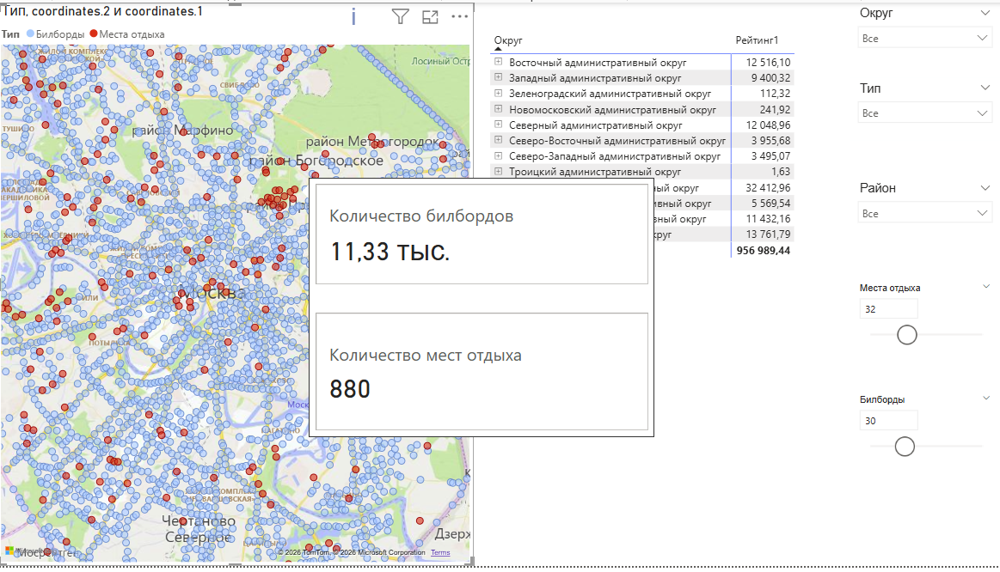
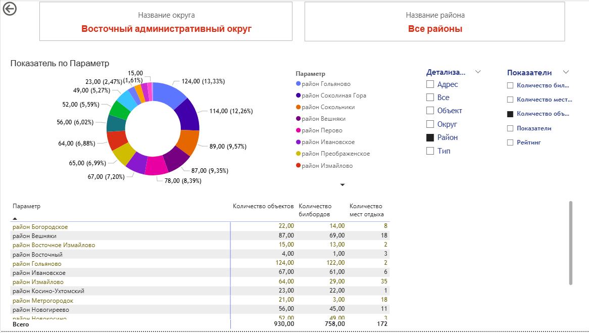

# Геопространственный анализ объектов Москвы | Power BI

## О проекте

Интерактивный аналитический отчёт в Power BI для исследования географического распределения билбордов и мест отдыха на территории Москвы и Московской области.

Проект объединяет картографическую визуализацию, анализ объектов по административным округам и районам, интерактивную фильтрацию и переключение показателей.

## Цели проекта

- Визуализировать географическое расположение объектов.
- Исследовать распределение билбордов и мест отдыха.
- Сравнить показатели по административным округам и районам Москвы.
- Реализовать интерактивную детализацию данных.
- Создать инструменты для выбора и сравнения показателей.

## Инструменты и методы

- **Power BI Desktop** — разработка интерактивного отчёта.
- Картографические визуализации с географической привязкой объектов.
- Анализ данных по административным округам и районам.
- Интерактивные фильтры и срезы.
- Переключение показателей и уровней детализации.
- Таблицы и диаграммы для сравнительного анализа.

## 1. Географическое распределение объектов

На интерактивной карте представлено расположение билбордов и мест отдыха.

Картографическая визуализация позволяет исследовать пространственное распределение объектов и их концентрацию на территории Москвы и Московской области.

Предусмотрена фильтрация по административному округу, району и типу объекта.

## 2. Анализ по округам и районам

Вторая часть отчёта предназначена для более подробного изучения объектов в разрезе административно-территориального деления Москвы.

Реализованы:

- Выбор административного округа и района.
- Детализация информации по объектам.
- Сравнение количественных показателей.
- Переключение отображаемых параметров.

## Возможности отчёта

Отчёт включает несколько страниц:

1. **Карта** — географическое расположение объектов.
2. **Карта (альтернативный вариант)** — дополнительное представление картографических данных.
3. **Детализация** — анализ объектов с выбором уровня детализации.
4. **Подсказка** — вспомогательная информация.
5. **Переключатель мер** — настройка отображаемых показателей.
6. **Меры** — вспомогательные элементы отчёта.

## Файлы проекта

- `Moscow_Geospatial_Analysis.pbix` — интерактивный отчёт Power BI.
- `screenshots/` — изображения картографического анализа и детализации.
- `README.md` — описание проекта.

Для полноценной работы с интерактивными картами необходимо открыть файл `.pbix` в Power BI Desktop. Некоторые картографические визуализации требуют подключения к интернету и разрешения на использование карт в настройках безопасности Power BI.

## Автор

**Ирина Курдюкова**

Финансовый специалист с опытом аналитической и контрольной работы. Развиваю навыки анализа данных, SQL, Python, Pandas и Power BI.
